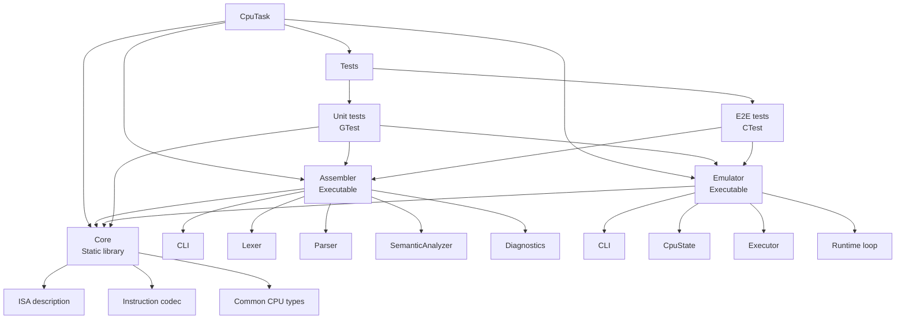
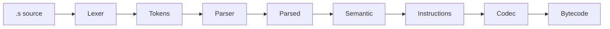
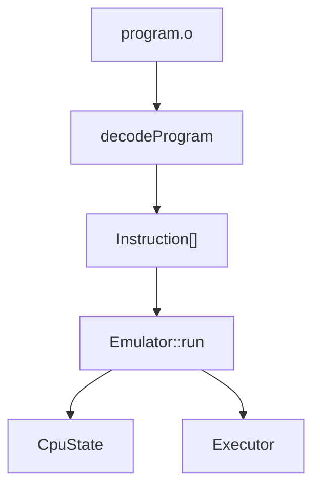
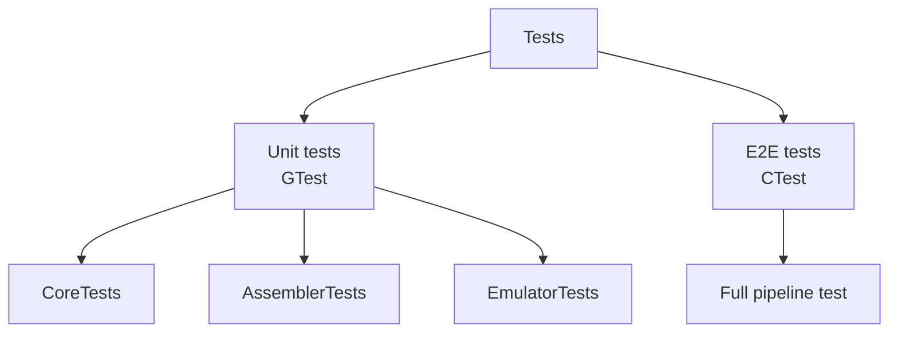
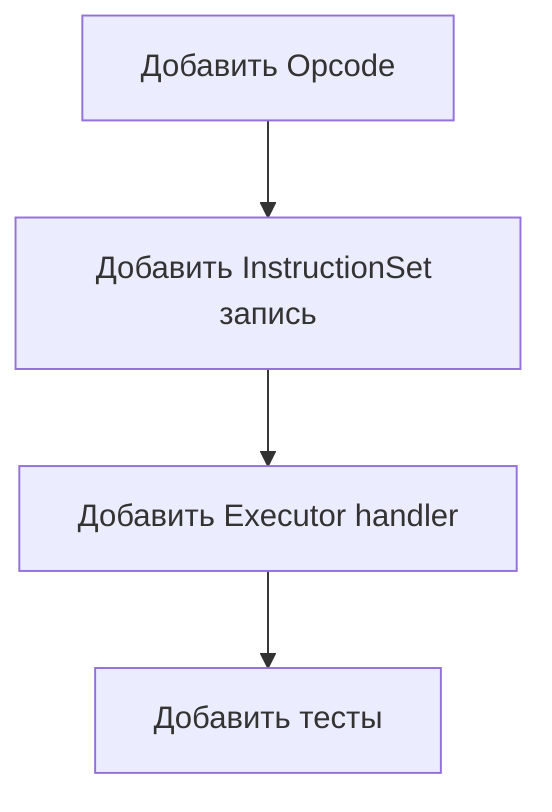

## Сборка и запуск

### Требования

Для сборки проекта нужны:

- C++20-совместимый компилятор;
- CMake 3.20 или новее;
- система сборки, поддерживаемая CMake;
- доступ к интернету при первой конфигурации для загрузки GoogleTest.

### Сборка проекта

Все команды выполняются из корневой директории проекта:

```bash
cmake -S . -B build
cmake --build build
ctest --test-dir build --output-on-failure
```

После сборки в будут созданы основные исполняемые файлы:

```text
Assembler
Emulator
UnitTests
```

### Запуск ассемблера

```bash
./build/Assembler/bin/Assembler program.s program.o
```

Ассемблер читает текстовый файл `program.s` и создаёт бинарный файл `program.o`.

### Запуск эмулятора

```bash
./build/Emulator/bin/Emulator program.o
```

Эмулятор читает бинарный файл `program.o`, выполняет инструкции и выводит итоговое состояние регистров.

### Запуск тестов

Проект использует два уровня тестирования:

- `UnitTests` — unit-тесты на GTest;
- `E2EFullFlow` — полный flow-тест через запуск `Assembler` и `Emulator`.

Запуск всех тестов:

```bash
ctest --test-dir build --output-on-failure
```

Запуск только unit-тестов:

```bash
ctest --test-dir build -L UnitTests --output-on-failure
```

Запуск только E2E-теста:

```bash
ctest --test-dir build -R E2EFullFlow --output-on-failure
```

Просмотр списка зарегистрированных тестов:

```bash
ctest --test-dir build -N
```

## Архитектура проекта

Проект реализует простой CPU с собственной ISA (Instruction Set Architecture), ассемблером и эмулятором. Архитектура построена модульно и разделена на три независимых слоя:

- **Core** — общая библиотека с ISA и кодеком
- **Assembler** — преобразует текст в байткод
- **Emulator** — исполняет байткод

Такое разделение позволяет:
- переиспользовать ISA между компонентами
- независимо тестировать каждый слой
- легко расширять систему новыми инструкциями

---

## Общая схема архитектуры




## Ассемблер

Ассемблер реализует pipeline преобразования текста в байткод.



### Этапы

1. **Lexer**  
   текст → токены  

2. **Parser**  
   токены → синтаксическое представление  

3. **SemanticAnalyzer**  
   проверка корректности и преобразование в инструкции  

4. **Codec**  
   инструкции → бинарный формат  

---

## Эмулятор

Эмулятор исполняет байткод.



### Компоненты

- **CpuState** — состояние регистров и PC  
- **Executor** — выполнение инструкций  
- **Dispatch** — таблица обработчиков opcode  

---

## Тестирование

Тесты разделены на два уровня:



### Unit tests

Проверяют:
- Core (ISA, Codec)
- Assembler pipeline
- Emulator execution

### E2E тест

Проверяет полный сценарий:

```
.s → Assembler → .o → Emulator → результат
```

---

## Почему такая архитектура

### 1. Разделение ответственности

- Core — описание CPU  
- Assembler — трансляция  
- Emulator — выполнение  

### 2. Расширяемость

Добавление новой инструкции:



Assembler автоматически начинает её поддерживать через `InstructionSet`.

---

### 3. Тестируемость

Каждый слой можно тестировать отдельно:

- Lexer отдельно  
- Parser отдельно  
- Executor отдельно  

---

### 4. Отсутствие дублирования

ISA описана в одном месте (`Core`), и используется:
- ассемблером
- эмулятором
- тестами

---